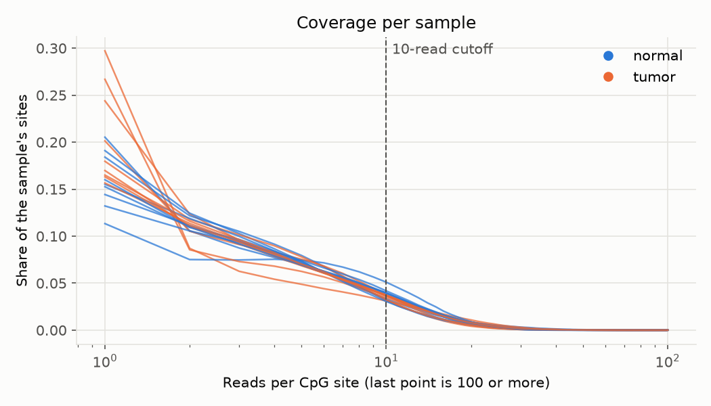
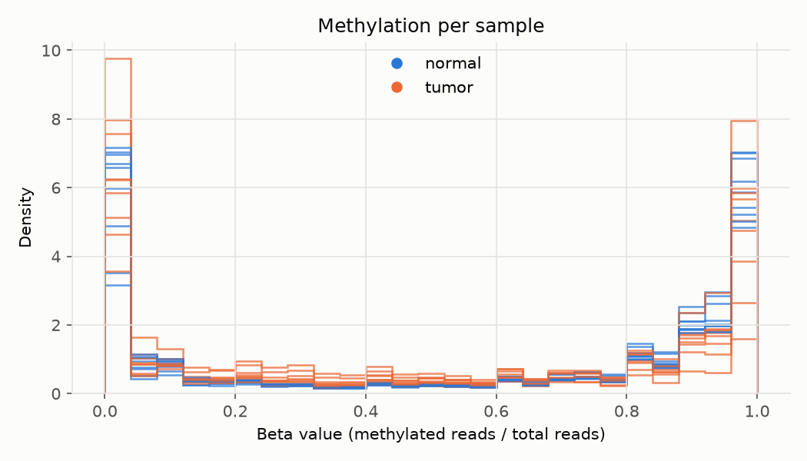
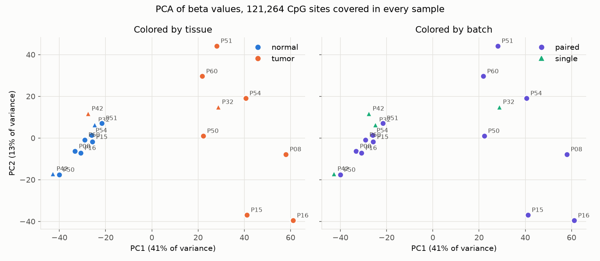

# Walkthrough

How 18 public RRBS (reduced representation bisulfite sequencing) samples became a beta table and a QC (quality control) report, one stage at a time, with the numbers each stage produced and what went wrong. Every stage is one `scripts/run.sh` call on AWS (Amazon Web Services) Batch; each section says which.

All numbers come from real runs recorded in `TODO.md` and from the run files in [`reports/`](reports/).

## Terms used throughout

- **Bisulfite conversion:** a chemical treatment that turns unmethylated cytosine into uracil, read as T (thymine) after amplification. Methylated cytosine stays C (cytosine). So at each site, a C in a read means that molecule was methylated and a T means it wasn't.
- **CpG (cytosine followed by guanine):** the two-base context where nearly all methylation in human DNA (deoxyribonucleic acid) sits. Bismark reports the two cytosines of a CpG (cytosine followed by guanine) site, one per strand, as separate rows.
- **RRBS (reduced representation bisulfite sequencing):** bisulfite sequencing of only the short fragments an enzyme (MspI) cuts at CCGG (cytosine-cytosine-guanine-guanine) sites. Cheap, and dense at promoters and CpG (cytosine followed by guanine) islands; blind to most of the genome.
- **Read trimming:** cutting adapter sequence and low-quality bases off read ends before alignment.
- **Alignment:** finding where each read came from in the reference genome. Bisulfite reads need a special aligner, because converted Ts (thymines) look like mismatches to a normal one.
- **Methylation calling:** counting, at each site, how many reads show it methylated and how many unmethylated.
- **Coverage:** how many reads cover a site. At 2 reads, the beta value can only be 0, 0.5, or 1.
- **Beta value:** methylated reads over total reads at one site, from 0 (never methylated) to 1 (always).
- **Bisulfite conversion rate:** the share of unmethylated cytosines that converted. Estimated from cytosines outside CpG (cytosine followed by guanine) sites, which are almost never methylated in human tissue. At 99%, about 1 in 100 unmethylated cytosines reads as methylated, which sets a floor on false methylation.
- **Duplicate rate:** the share of reads that look like copies of another read. High in RRBS (reduced representation bisulfite sequencing) by design.
- **PCA (principal component analysis):** projects samples onto the directions where they differ most. PC1 (principal component 1) is the direction with the most variation.
- **Batch effect:** differences caused by how samples were processed, not by biology.

## 0. Pick a dataset

Searched SRA (Sequence Read Archive) for human RRBS (reduced representation bisulfite sequencing) studies with 10 to 40 samples: 146 matched and 6 made the shortlist. Each candidate's group labels were checked in its BioSample metadata before choosing.

**Chosen: GSE95654 (GEO (Gene Expression Omnibus) Series 95654), SRA (Sequence Read Archive) study SRP101332.** Primary tumor and adjacent normal colon from KRAS-mutant colorectal cancer patients, Illumina HiSeq 2500, from Hanley et al., *Oncogene* 2017. Tumor against matched normal from the same patient is the comparison an MCED (multi-cancer early detection) assay builds on.

Two decisions, both recorded in `config/gse95654/runs.tsv`:

- **Dropped patient 41.** The tumor run, SRR5311101, has the same quality score (`?`) on every base in both NCBI (National Center for Biotechnology Information) and ENA (European Nucleotide Archive). Quality trimming and Bismark's mismatch scoring both need real scores, so the whole pair is out. That leaves 9 patients and 18 samples.
- **Read layout is a batch.** Patients 32 and 42 were sequenced single-end (1 x 100 bases); the other 7 paired-end (2 x 100). Each patient's tumor and normal share a layout, so layout differs between patients but isn't tied to tumor versus normal.

## 1. methylseq test profile

`scripts/run.sh methylseq config/methylseq/test.yaml`

nf-core/methylseq 4.2.0 on its bundled test data. The first run used local Docker (container software): 36 tasks, 272 seconds including container downloads. It proved the pins before any real data was fetched. Nextflow is pinned to 25.04.0 because newer versions reject methylseq 4.2.0's config, which includes a file, `conf/aws/batch/nextflow.config`, that is missing from the release tag.

Everything later moved to AWS (Amazon Web Services) Batch after the local Docker (container software) profile ran out of memory sharing Docker Desktop with other projects.

## 2. Fetch and downsample

`scripts/run.sh fetch_sra config/fetch_sra/gse95654.yaml`

`pipelines/fetch_sra` runs one task per sample on Batch: `prefetch` (checks each file's MD5 (Message Digest 5) checksum), `fasterq-dump`, then `seqtk sample` to a fixed read count with seed 42, so the subset is reproducible. The unpacked FASTQ (sequence reads with quality scores) files never leave the instance. The pipeline also downloads GENCODE release 50 GRCh38 (human reference genome, build 38) and checks its MD5 (Message Digest 5), then writes methylseq's sample sheet.

The first fetch took 5 million read pairs per sample.

## 3. methylseq on 5 million reads

`scripts/run.sh methylseq config/methylseq/gse95654.yaml`

All 18 samples trimmed, aligned, and methylation-called, with 0 failed tasks. This run also built the Bismark index for GRCh38 (human reference genome, build 38), which later runs reuse.

- Reads after trimming: 4.68 to 4.94 million of 5 million per sample.
- Mapping rate: 62.7% to 70.6%, normal for RRBS (reduced representation bisulfite sequencing). The single-end patients fall inside the paired-end range.
- Bisulfite conversion, from Bismark's CHH (cytosine followed by two non-guanine bases) methylation: 99.42% to 99.62%, above the usual 99% bar in every sample.

## 4. Convert to the beta table

`scripts/run.sh convert config/convert/gse95654.yaml`

`src/methyl_flow/convert.py` reads each sample's Bismark coverage file (`.bismark.cov.gz`: chromosome, position, methylated reads, unmethylated reads). It keeps chr1 to chr22, chrX, and chrY, and sites with at least 10 reads (`--min-coverage`), then computes beta = methylated / total. A full outer join puts every sample in one table, with a missing value where a sample fell below 10 reads.

It writes the two files methyl-floor reads:

- `samples.tsv`: methyl-floor's 12 sample sheet columns. `sample_id` is the GSM (GEO (Gene Expression Omnibus) sample) accession, `tissue` is tumor or normal, `batch` is read layout.
- `betas/GSE95654.parquet`: a `probe` column (`chrom:position`) and one beta column per sample.

At 5 million reads: 646,687 sites across 18 samples. `tests/test_convert.py` checks the filters, the beta math, file matching, and the merge on small fixture files. It also loads both outputs with methyl-floor's own loader when that repo is installed (`uv run --with ../methyl-floor pytest`).

## 5. QC (quality control) shows 5 million reads is too thin

`scripts/run.sh qc config/qc/gse95654.yaml`

The first QC (quality control) pass made the problem plain: **the median CpG (cytosine followed by guanine) site had 2 reads**, and only 165 sites reached 10 reads in all 18 samples. A beta value from 2 reads can only be 0, 0.5, or 1, too coarse to compare tumor with normal. PCA (principal component analysis) on 165 sites says little.

Every run in the study has at least 29.7 million read pairs, so there was room to go deeper.

## 6. Rerun at 20 million reads

```bash
scripts/run.sh fetch_sra config/fetch_sra/gse95654_20m.yaml
scripts/run.sh methylseq config/methylseq/gse95654_20m.yaml
scripts/run.sh convert config/convert/gse95654_20m.yaml
scripts/run.sh qc config/qc/gse95654_20m.yaml
```

Same samples, same seed, 20 million read pairs each, written to a separate S3 (Amazon Simple Storage Service) prefix so the 5 million read data stays intact. methylseq reused the Bismark index from step 3, which skipped the slowest one-time step.

Spot reclaimed the instance aligning P51_normal three times, and Nextflow gave up after its 3 Spot attempts, which ended the run. `scripts/run.sh ... --resume <session-id>` picked it up from S3 (Amazon Simple Storage Service): trimming and FastQC (read quality checker) came back from cache, and the remaining alignments finished. P51_normal's alignment alone took 2 hours 24 minutes.

- Mapping rate: 62.7% to 70.5%, unchanged from 5 million, as expected for the same libraries.
- Beta table: 5,276,298 sites, up from 646,687.

## 7. QC (quality control) at 20 million reads



- **Conversion: 99.33% to 99.56%** (CHG and CHH (cytosine contexts outside CpG sites) combined), above 99% everywhere.
- **Median coverage: 4 to 7 reads** per CpG (cytosine followed by guanine) site, up from 2. Sites at 10 or more reads: 18.5% to 33.0% per sample (1.2 to 2.7 million sites), up from 0.4% to 3.5%.
- **Duplicate rate: 64% to 75%**, up from 46% to 57%. That's expected: RRBS (reduced representation bisulfite sequencing) reads start at enzyme cut sites, and sampling deeper into the same libraries re-reads the same fragments.
- **Single-end patients cover fewer cytosines:** 5.7 to 6.4 million, against 7.2 to 9.2 million for paired-end.



Beta values pile up near 0 and 1 in every sample, as they should at CpG (cytosine followed by guanine) sites. In Bismark's own summary, the share of methylated CpG (cytosine followed by guanine) calls drops from normal to tumor in P15 (61.7% to 31.1%), P16 (51.0% to 41.8%), P32, and P50. Tumor-wide loss of methylation is a known feature of colorectal cancer. P42 goes the other way (58.9% to 62.6%), and P08, P51, P54, and P60 change by 2.6 points or less.



PCA (principal component analysis) on the 121,264 sites with a beta value in all 18 samples: **PC1 (principal component 1) explains 41% of the variance and separates 8 of 9 tumors from the normals.** P42's tumor sits with the normals, at both read depths. Read layout doesn't separate samples on PC1 (principal component 1) or PC2 (principal component 2), so the paired-end and single-end batch isn't driving the signal.

## 8. Interactive reports

Every run writes interactive HTML (web page) reports next to its output. Copies from the 20 million read runs are in [`reports/gse95654_20m/`](reports/gse95654_20m/):

- methylseq's MultiQC (combined quality control) report: every tool's per-sample metrics in one page.
- The QC (quality control) report from `src/methyl_flow/report.py`: the sortable per-sample table, then coverage, methylation, and PCA (principal component analysis) charts with hover.
- Nextflow's execution report and timeline for methylseq and for QC (quality control): run time, CPU, and memory per task.

## Next: differential methylation (Build E)

DSS (Dispersion Shrinkage for Sequencing data), in R, will test each CpG (cytosine followed by guanine) site for a tumor versus normal difference, then call DMRs (differentially methylated regions): runs of nearby sites that change together. Thousands of tests mean some look significant by chance, so the count that matters is how many DMRs (differentially methylated regions) survive FDR (false discovery rate) correction. DSS (Dispersion Shrinkage for Sequencing data) will read methylated and total counts per site, not beta values, because a beta from 4 reads and a beta from 40 reads deserve different weight.
